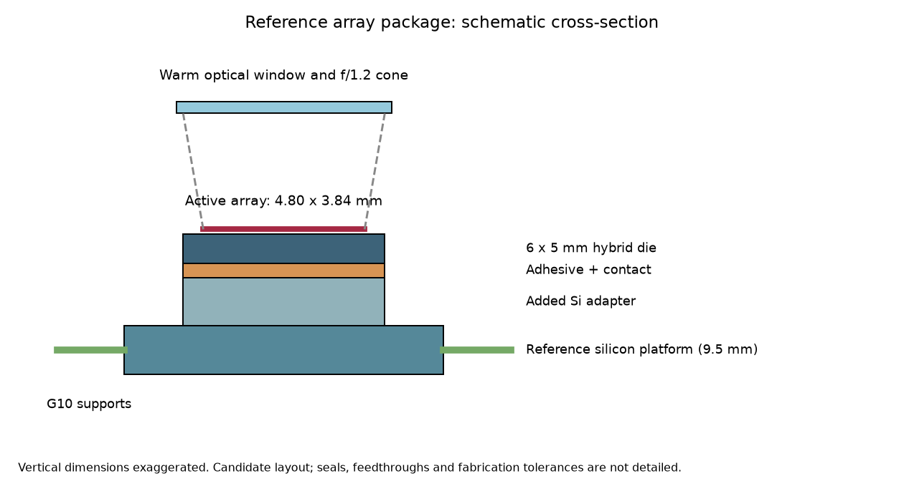

# Joule–Thomson Cooler Integration for Infrared Microsystems

A reproducible Python study of how supports, wiring, insulation and bond interfaces
limit useful cooling in a reference infrared-array package.

**Main result:** of 1,134 package geometries, seven meet a provisional 10 mW
requirement at a 100 K peak-die limit under a prescribed adverse scenario. The
selected candidate permits **28.5 mW nominally and 11.5 mW in that scenario**.
These are conditional simulations using measured reference-cooler capacity;
the proposed package has not been experimentally validated.



## Read the project

- [Complete technical report in Word](output/JT_Microsystems_Complete_Technical_Report.docx): detailed methods, results and appendices.
- [Term-paper draft](docs/term_paper.md): question, methods, results, discussion and references.
- [Results overview](results/advanced/overview.md): numerical findings and original figures.
- [Reproduction instructions](docs/reproducibility.md): commands, dependencies and evidence map.
- [Portfolio and resume summary](docs/portfolio_summary.md).
- [Milestone status](docs/milestone_status.md).

## Exchanger physics and bond quality

[Extension results](results/extensions/report.md) and [methods](docs/extension_methods.md)
add coupled gas/wall/insulation temperatures and spatial interface defects.
A 25% central degraded bond patch lowers the selected adverse power limit to
10.48 mW; a 50% edge strip lowers it to 8.43 mW. These are thermal sensitivity
cases, not measured manufacturing tolerances. The distributed exchanger stays
on the vapor-return branch and does not replace the 100 K measured-capacity map.

## What is implemented

- A 320 × 256, 15 µm-pitch reference array, with explicit sourced and assumed inputs.
- Geometry-based thermal networks using temperature-dependent conductivity,
  spectral optical loading and a measured cooler-capacity curve.
- Three-dimensional thermal and two-dimensional thermoelastic finite elements,
  mesh studies, support stiffness and lead-resistance screens.
- A 1,134-design constrained grid search and selected-candidate FE confirmation.
- Passive local power-step simulation with thermal-capacitance sensitivity.
- Separate real-fluid model, calibration/holdout audit, and reproduction of recent
  published gas-runtime and supplementary heat-budget calculations.
- 43 automated verification tests covering physical balances and analytical limits.

## Run

Python 3.10 or newer; execute from this directory:

```sh
python -m pip install -r requirements.txt
python -m unittest -v
python run_array_fem.py
python run_calibration_audit.py
python run_external_validation.py
python run_supplement_audit.py
python run_array_optimization.py
python run_array_transient.py
python run_distributed_hx.py
python run_bond_defects.py
python build_extension_report.py
python build_advanced_overview.py
```

The optimization may take time. The transient reads the optimization output.
Scripts use local inputs and require no publisher PDFs or network access.
See [reproducibility details](docs/reproducibility.md) for saved-result locations
and the recorded software environment.

## Evidence and limits

The package uses Qi's measured net capacity at its published boundary conditions;
only additional package heat leaks are applied. The independent real-fluid baseline
has material capacity errors and does not establish the quoted package ratings.

The 2026 supplementary calculation is reproduced to published rounding. Its
exhaust loss is a residual using measured net power, so recovering net power from
that residual is not independent validation. Neither controlled optical tests nor
results from different experimental chips validate the passive array model.

- [Reference design and assumptions](docs/01_array_specification.md)
- [Methods and limitations](docs/advanced_methods.md)
- [Calibration audit](results/advanced/03_validation_audit.md)
- [Full-text evidence ledger](docs/benchmark_candidates.md)
- [Supplement reproduction](results/advanced/07_supplement_audit.md)

The actual detector pinout, stack, material properties, bond reliability,
pressure enclosure and vacuum retention remain unqualified. Adverse scenarios
are deterministic assumption screens, not statistical confidence bounds.

## Sources

Recent journal sources are Qi et al., *Applied Thermal Engineering* (2023),
[120361](https://doi.org/10.1016/j.applthermaleng.2023.120361); Tong et al.,
*Cryogenics* (2024), [103929](https://doi.org/10.1016/j.cryogenics.2024.103929);
Pei et al., *Review of Scientific Instruments* (2024),
[085118](https://doi.org/10.1063/5.0214551); and Pei et al., *Cryogenics* (2026),
[104445](https://doi.org/10.1016/j.cryogenics.2026.104445), including Supplement S1–S3.
NIST property fits supply temperature-dependent conductivity. Full references and
source roles are in the paper and input ledgers.

## Repository scope

`config/` holds assumptions; `data/` holds short derived numerical records;
`results/advanced/` holds the final reference-array study. Earlier outputs and
[historical documentation](docs/exploratory_readme.md) preserve exploratory work;
the earlier smaller placeholder detector is not the final reference array.

Original code, reports and figures are prepared for local review. Publisher PDFs,
full-text extractions and temporary files are excluded by `.gitignore`. No open-source license has yet been selected; public visibility does not itself grant general reuse rights.

## Upload and report generation

See [upload instructions](docs/github_upload.md) for repository setup and bundle contents.
The scientific calculations use `requirements.txt`. To rebuild the Word report from
the saved results, install `requirements-report.txt` and run `python build_word_report.py`.
Open the resulting DOCX in Word and update the table of contents and fields before exporting.
The Word report is currently kept locally and is excluded from this public upload.
