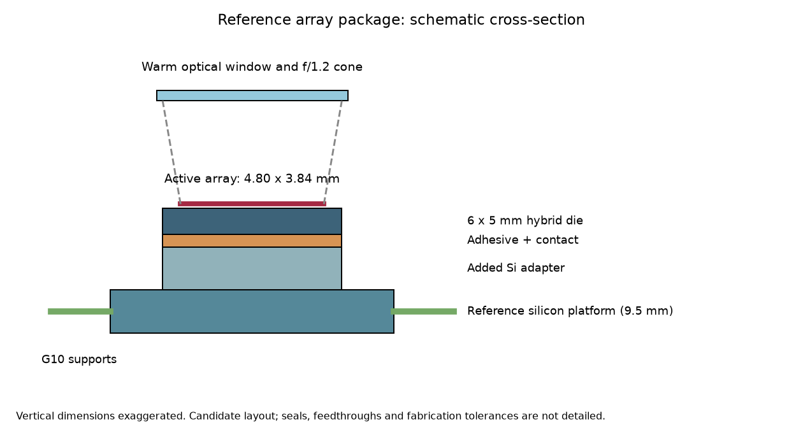
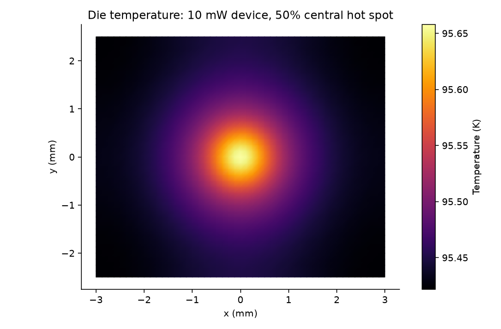
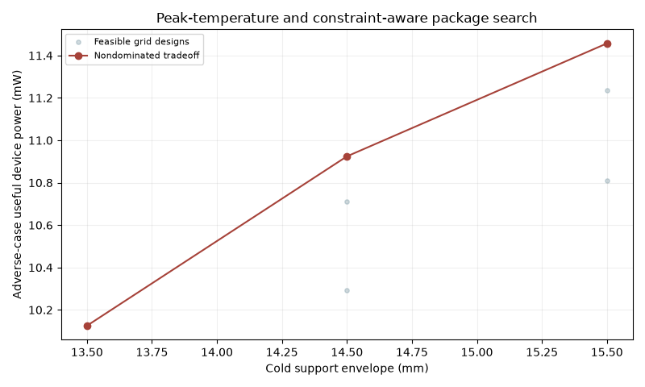
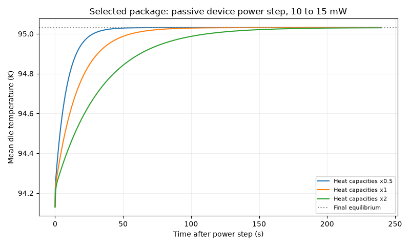
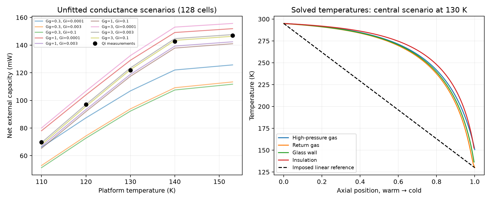
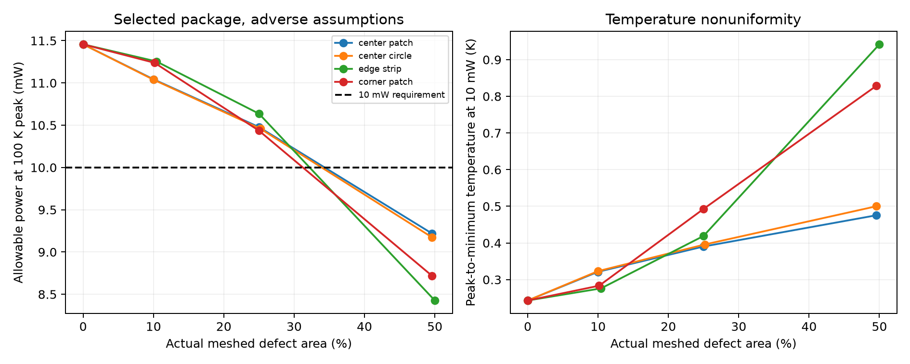
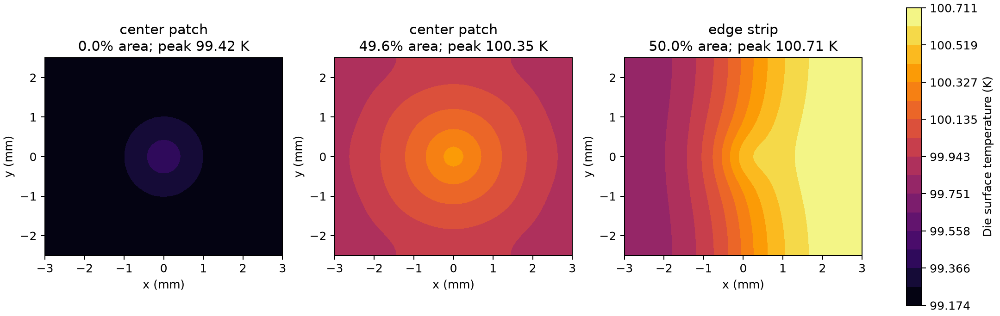

# Packaging-Constrained Joule–Thomson Cooling for a Reference Infrared Microsystem

**Term-paper draft — 30 September 2026**  
Computational design study; author and course details to be added before submission.

## Abstract

A miniature Joule–Thomson (JT) cooler must remove both device dissipation and heat
introduced by its package. This study investigates that integration problem for
a reference 320 × 256 infrared array with a 15 µm pixel pitch. A measured nitrogen
cooler capacity curve is coupled to a geometry-based thermal network, a
three-dimensional thermal finite-element model, a two-dimensional thermoelastic
cross-section, and preliminary support and wiring constraints. A search of 1,134
package geometries identifies seven candidates meeting an assumed 10 mW device
load at a 100 K peak-die limit under a prescribed adverse scenario. The selected
candidate permits 28.5 mW nominally and 11.5 mW in that scenario. A local passive
10-to-15 mW power step settles within 2% of its final temperature change in about
65 s under assumed thermal capacitances. Separate reproduction of a recent
published heat budget recovers approximately 234 mW gross refrigeration but
only 5.3 mW measured net cooling in that experimental assembly. Spatial bond-defect studies further show that a 50% poorly conducting edge region
reduces the selected adverse allowable power to 8.43 mW. A distributed gas/wall/
insulation model investigates exchanger losses while revealing unresolved internal
heat-flow assumptions. The work shows why cooler capacity alone is insufficient
for microsystem design. Results are
conditional design estimates, supported by numerical verification and source
audits; independent experimental validation of the proposed package remains open.

## 1. Introduction and research question

JT refrigeration produces cooling through an approximately isenthalpic expansion
under suitable fluid conditions. Miniaturizing the cooler can bring refrigeration
close to a small sensor, but it does not eliminate warm supports, electrical
connections, radiating surfaces or imperfect thermal interfaces. The relevant
design outcome is therefore useful device power at an acceptable device
temperature, rather than refrigeration measured without the added device package.

Qi et al. report experimental performance of a micromachined nitrogen cooler
and provide the capacity data used here [1]. Tong et al. supply an infrared-array
format and packaging context [2]. These sources concern different hardware:
the present design uses Tong's array format with Qi's reference cooler; it does
not claim to reproduce Tong's integrated assembly. Pei et al.'s 2024 controlled
sample stage [3] and 2026 gas-supply/detector study [4] provide more recent evidence
on interfaces, thermal control and practical system integration.

The research question is: **Which combinations of support, wiring and bond
geometry can keep a reference array below a 100 K peak temperature while meeting
provisional mechanical and electrical constraints?** The contribution is a
reproducible comparison of these competing requirements, with a clear separation
between measured inputs, design assumptions and numerical predictions.

## 2. Reference package and evidence basis

The array format is 320 × 256 at 15 µm pitch, giving a 4.80 × 3.84 mm active area
[2]. A 6 × 5 × 0.30 mm homogenized die envelope provides an assumed border and
readout allowance. Its detailed composition, pinout and power are not specified
by a manufacturer. The 100 K target and 10 mW dissipation are project requirements.
The detector sits above an added silicon adapter and adhesive bond on the
reference cooler's silicon platform. Four G10 supports carry a 450 mg cold-assembly
allowance. The enclosure allocation is 70 × 25 × 15 mm, accommodating the 60 mm
cooler; it is not a pressure-rated fabrication design.

| Quantity | Reference value | Basis |
|---|---|---|
| Array format; optical cone | 320 × 256, 15 µm; f/1.2 | Tong [2] |
| Cooler/platform | 60 mm cooler; 9.5 × 9.5 mm silicon platform | Qi [1] |
| Ambient and nitrogen pressures | 295 K; 11.1/0.24 MPa | Qi capacity experiment [1] |
| Added adapter | 6 × 5 × 0.50 mm | Assumption |
| Baseline bond | 50 µm, nominal full-area contact | Assumption |
| Wiring | Twelve 25 µm signal wires; four 75 µm power/return wires | Assumption |
| Baseline supports | Four 2 × 0.5 × 0.2 mm G10 tabs | Assumption |
| Device target | 10 mW; peak temperature ≤100 K | Project requirement |
| Supported mass; acceleration | 450 mg; 10 g | Screening assumptions |

Temperature-dependent support and wire conductivities use NIST fits [5,6].
Contact resistance, homogenized die conductivity, elastic properties, thermal
expansion coefficients and heat capacities remain explicit assumptions. The
complete ledger is in [the reference specification](01_array_specification.md)
and `config/array_design.json`.



*Figure 1. Conceptual integration of the added detector stack and reference
cooler. Dimensions describe the computational surrogate, not fabrication CAD.*

## 3. Methods

### 3.1 Measured capacity and thermal network

The principal package study interpolates the increasing 88.5–153 K branch of
Qi's measured net cooling capacity [1]. Intermediate points are approximate
manual readings, with stated graph-reading allowances. Linear interpolation
avoids overshoot; the curve is not extrapolated to other pressures or ambient
conditions. Its temperature corresponds to the measured reference silicon
platform, not the expanding fluid.

Let Tc be platform temperature, Td mean die temperature, Hd the additional loads
entering the die, and Hc those entering the platform. At steady state,

```text
Td − Tc = Rinterface Hd(Td)
Qreference(Tc) = Hd(Td) + Hc(Tc).
```

The interface resistance combines adapter, adhesive, contact and effective die
resistances. Conduction along a member uses `(A/L) integral[k(T)dT]`; radiation
uses effective area, emissivity and fourth-power temperature difference. Optical
loading integrates a specified 3–5 µm transmission scenario and the f/1.2 cone,
with a separate out-of-band transmission assumption. The warm window is not an
independent thermal node. Residual-gas conduction is an effective conductance.

Only **additional package loads** are applied to the measured net capacity.
Losses from Qi's existing platform, insulation and instrumentation are already
embedded in that measurement and must not be subtracted again. This accounting
rule is essential when transferring measured cooler performance into a package study.

### 3.2 Spatial thermal and mechanical analysis

Linear tetrahedral elements model conduction through the adapter, effective bond
and homogenized die. The bottom boundary is isothermal at Tc and the sides are
adiabatic. Half of device dissipation is applied through a Gaussian hot spot of
0.35 mm standard deviation; the remainder and other die loads are distributed
uniformly. This is an imposed load scenario, not a measured readout heat map.

A separate plane-stress bonded cross-section estimates cooldown mismatch using
constant effective elastic properties and expansion coefficients. Constraints
remove rigid motion while allowing longitudinal contraction. Central die stress
is reported away from free edges, where idealized bonded models can develop
large mesh-dependent stresses. No measured joint-strength or fatigue criterion
is available, so this calculation does not establish bond reliability.

Analytical checks include layered conduction under uniform flux, zero stress
for matched thermal contraction, and energy/force balance. Mesh refinement
assesses the reported temperatures, warpage and central stress.

### 3.3 Constrained search and transient response

The grid varies support length, width and thickness, wire length and bond
thickness over 1,134 combinations. Screening limits include ≤10 µm support
deflection, ≤50 MPa support stress, and ≤20/2 Ω signal/power lead resistance.
These are provisional requirements. The objectives are useful device power
under the adverse scenario and cold support envelope. Peak-temperature limits
use an FE-derived peak-minus-mean coefficient, followed by full FE recalculation
of the selected boundary cases.

The adverse scenario combines a lower capacity-reading curve with support
conductivity +20%, wire conductivity +10%, doubled contact resistance and opaque
emissivities, increased gas and out-of-band optical loads, wire resistivity +20%,
and support modulus −30%. It is a deterministic stress test, not a confidence
interval or guaranteed worst case.

Local dynamics use two thermal storage nodes with a quasi-steady cooler map:

```text
Cd dTd/dt = Hd − (Td − Tc)/Rinterface
Cp dTc/dt = Hc + (Td − Tc)/Rinterface − Qreference(Tc).
```

Nominal capacitances are 0.008 and 0.10 J/K for die and platform. Both are varied
by factors of 0.5 and 2. This approximation excludes startup from room temperature,
fluid inventory dynamics and feedback control.

## 4. Results

### 4.1 Baseline package and finite elements

At 10 mW device dissipation, the baseline predicts a 94.99 K platform and 95.46 K
mean die. The fine thermal mesh gives a 95.66 K peak, with about 0.006 K change
from the preceding mesh. Support conduction is approximately 26.3 mW and lead
conduction 7.3 mW, both substantial relative to the useful device load. The
baseline power limit is 22.4 mW at a **mean-die** target of 100 K. This is a
different criterion from the peak-die limit used in optimization and should not
be presented as a like-for-like percentage improvement.



*Figure 2. Computed baseline temperature field under the assumed spatial load.
Mesh convergence verifies the numerical solution within the stated model.*

### 4.2 Feasible geometries and selected candidate

Of 1,134 designs, 372 pass the adverse mechanical and electrical screens, and
seven also support at least 10 mW at the 100 K peak-temperature limit. The selected
candidate uses four 3.0 × 0.3 × 0.35 mm supports, 8 mm leads and a 25 µm bond.
Its cold support envelope is 15.5 mm.

| Selected-candidate result | Value |
|---|---:|
| Nominal allowable device power, 100 K peak | 28.5 mW |
| Adverse allowable device power, 100 K peak | 11.5 mW |
| Adverse support deflection | 6.62 µm |
| Predicted cooldown warpage | 3.71 µm |
| Central die equivalent stress | 16.8 MPa |

The full FE recalculation recovers the 100 K peak boundary for both power limits.
The 25 µm bond improves heat transfer but has a higher predicted mismatch
warpage than the baseline. The selected geometry lies on the lower bond-thickness
bound of the grid, making bond manufacturing and reliability particularly important.
The 11.5 mW adverse result leaves only about 1.5 mW above the assumed requirement.
It is a narrow conditional margin, not a qualified hardware rating.



*Figure 3. Useful cooling-power and support-envelope tradeoff within the enumerated
design grid. Feasibility depends on the stated electrical, mechanical and thermal assumptions.*

### 4.3 Local power-step response

For the selected package under nominal conditions, a 10-to-15 mW device step
raises mean die temperature from 94.13 to 95.03 K. The 2% settling time is
65.4 s, ranging from 32.7 to 130.8 s across the capacitance scenarios. Tightened
integration tolerances change the solution by about 1.1 × 10⁻⁷ K. The 15 mW
endpoint exceeds the adverse allowable power, so this demonstration is nominal
only. Neither solver convergence nor energy closure establishes the accuracy
of the assumed thermal masses.



*Figure 4. Passive local power-step response using assumed thermal capacitances
and a quasi-steady measured cooler curve; no PID controller is included.*

## 5. Validation assessment and recent literature comparison

### 5.1 Real-fluid model and calibration limits

A separate CoolProp nitrogen model includes enthalpy-based recuperation,
prescribed pressure drops and mass flow, isenthalpic expansion and phase tracking.
Its baseline capacity discrepancies are material, so it is not used to establish
the package power ratings. Fitting one empirical radiation-area multiplier to
Qi data at 100, 120 and 140 K gives a training RMSE of 2.60 mW; five held-out
temperatures give 7.62 mW, with poor transfer at 95 K. These are held-out points
from the same experiment, not independent experimental validation. The fitted
multiplier may absorb several missing loss mechanisms rather than identify a
physical surface correction.

### 5.2 Reproduction of the 2026 supplementary heat budget

Pei et al.'s Supplement S3 specifies 16.5 mg/s nitrogen flow, 295 K ambient,
130 K cold-head temperature and 7.0/0.285 MPa inlet/outlet pressures [4]. Using
these inputs without fitting reproduces the published estimates:

| Term | This reproduction | Published rounded estimate |
|---|---:|---:|
| Gross refrigeration | 234.05 mW | 234 mW |
| Cold-head radiation | 57.61 mW | 58 mW |
| Insulated exchanger radiation | 65.07 mW | 65 mW |
| Six copper leads | 35.90 mW | 36 mW |

An axial-conduction allowance below 2 mW gives approximately 158.6–160.6 mW
parasitics. Crucially, the reported exhaust loss is the residual after subtracting
these estimated loads and the **measured 5.3 mW net power** from gross refrigeration.
Consequently, recovering net power from that residual is circular. This comparison
supports reproducibility of the published calculations, not an independent
prediction of net capacity or exchanger effectiveness.

The supplement estimates 47.9 mW conduction for eight copper traces with a
detector, with possible additional shielding load. It also reports that an
alternative insulation-temperature model reduces estimated exchanger radiation
from about 65 to 25 mW. That model dependence exceeds the measured net capacity.
These findings reinforce the need for explicit wiring and insulation assumptions;
they are not extra losses to subtract from an already net-rated cooler curve.

### 5.3 System-level evidence and incompatible comparisons

The 2026 gas-system experiment reports about 75 min between cylinder replacements
[4]. A separate real-gas inventory calculation gives 75.5 min at an assumed
300 K cylinder temperature, or 72.9–78.3 min across 290–310 K. It uses a 0.5 L
cylinder from 29.5 to 9 MPa and 21 mg/s flow, excluding initial purge and cooldown.
This is conditional agreement with a gas-runtime observation, not thermal validation.
The supplement's startup example also contains an apparent constant-flow arithmetic
inconsistency: 54 g at 12 mg/s gives 75 min total, leaving 45 min after 30 min
cooldown rather than the stated 60 min. Variable flow might explain the difference,
but a supporting trace is unavailable.

Pei 2024 uses active PID heater compensation and incident laser loading with
unknown absorbed fraction [3]. Its small temperature excursion cannot validate
the passive electrical-step model. The 2026 gas tests and single-point detector
demonstration use different chips [4]; combining their results as one array
assembly would be inappropriate. Likewise, room-temperature vibration tests at
2 MPa do not establish cryogenic vibration at nominal operating pressure.

### 5.4 Distributed exchanger: improved resolution, unresolved internal physics

A new axial model solves separate high-pressure gas, counterflow return, shared
wall and effective insulation temperatures. Real-fluid enthalpy balances are
coupled to finite gas/wall conductances, axial wall conduction and insulation
radiation. Cell heat transfer uses an exponential local approximation with mean
heat capacity; warm/cold wall anchors are included in the energy balance. All
conductances and wall geometry simplifications are declared in the
[extension methods](extension_methods.md). No new parameter fitting is performed.

The constitutive screen varies gas-side and insulation-contact conductance at
five measured-flow points from 110 to 153 K. The model requires vapor return;
it does not claim a two-phase exchanger solution or extrapolate to 100 K. The
central130 K scenario predicts 118.87 mW on 128 cells and 119.33 mW on 256 cells,
compared with 121.9 mW from the published markers. The improved mesh changes net
capacity by 0.46 mW, but the internal heat budget remains problematic.

In particular, the assumed continuous wall and cold anchor produce hundreds of
milliwatts of conduction into the platform, compensated by evaporator heat uptake.
This is in tension with the small axial-loss scale in the reference model's
accounting, although the definitions and boundaries require reconciliation.
A close net capacity can therefore conceal an inadequate internal model. Energy
conservation and a positive whole-device entropy balance are necessary checks,
not validation of the assumed thermal paths. The measured capacity map remains
the basis for the original package ratings.



*Figure 5. Unfitted conductance scenarios and separate solved temperature profiles.
The scenario family is a sensitivity screen, not a confidence interval. Measured
flow is prescribed and only vapor-return cases are included.*

A separate130 K mean-die package calculation propagates the scenario curves
within their temperature domain. It illustrates uncertainty transfer but does
not change the original100 K peak-die requirement or establish infrared performance
at 130 K. Numerical comparisons and rejected finite-contact cases are retained
in the [extension report](../results/extensions/report.md).

### 5.5 Spatial bond defects: does the selected candidate retain its margin?

The selected 25 µm bond is assigned poorly conducting patches covering nominally
10%,25% and 50% of its area, located centrally, at an edge or in a corner. A circular
central shape is also considered. The principal conductivity ratio is10^-4 relative
to the intact effective bond; it is a sensitivity parameter, not a measured gap
property. Actual meshed areas are recorded.

For each defect, uniform and localized1 W FE load bases are computed. Their full
nodal fields are combined and their mean temperature is coupled back into the
package balance. This avoids incorrectly retaining the intact interface resistance
or adding separate maxima that occur at different locations. The original
support/wire geometry and nominal/adverse scenarios remain fixed.

| Adverse interface case | Allowable power at 100 K peak | Peak at 10 mW |
|---|---:|---:|
| Intact bond |11.46 mW |99.417 K |
|25% central rectangular patch |10.48 mW |99.799 K |
|Approximately 50% central rectangular patch |9.22 mW |100.350 K |
|50% edge strip |8.43 mW |100.711 K |

All four sampled 25% shapes retain the 10 mW requirement, but all approximately 50%
shapes fail under the adverse assumptions. The edge case can be more damaging
than a central defect at large area because heat must spread laterally to the
remaining bonded region. Thus defect area alone cannot define thermal acceptance.
The sampled fractions do not establish a precise permissible-void threshold.



*Figure 6. Allowable device power and temperature nonuniformity versus actual
meshed poorly conducting area. Rectangular patches preserve the die aspect ratio.*



*Figure 7. Selected adverse-case temperature fields at 10 mW device power. These
are thermal defect surrogates; no crack growth or mechanical strength is predicted.*

For an exactly 25% central patch, the allowable powers on mesh levels 4,8 and 12
are 10.496,10.478 and 10.474 mW. The intact case recovers the previous solver and
uniform whole-bond degradation recovers analytical layered resistance. Varying
the defect conductivity ratio from 10^-4 to 0.1 changes the 25% central-patch limit
from 10.478 to 10.607 mW. Thermal gap mechanisms and stress redistribution remain
unmodeled; these results cannot qualify defective-joint reliability.

## 6. Discussion: integration implications and limitations

The package creates coupled tradeoffs. Longer, thinner supports reduce conduction
but reduce stiffness; thinner wires reduce conduction but increase resistance;
a thinner bond improves heat transfer but changes mismatch deformation. The
small number of feasible adverse designs shows why independently optimizing
only the cooler or thermal path can produce an unusable package.

The largest remaining uncertainties concern the actual detector stack and
power distribution, bonded-interface quality, temperature-dependent mechanical
properties and insulation/gas behavior. Optical response, noise and imaging
performance are not predicted. Pressure containment, hermetic seals, vacuum
retention, getter selection, window strength and cryogenic joint qualification
require additional engineering. The local FE stack and support screen do not
represent a complete pressurized enclosure.

Independent thermal validation would require a compatible assembly with measured
geometry, boundary conditions, spatial temperatures and load history. An
independent exhaust measurement or established exchanger-loss model would help
close the real-fluid cycle without using the desired net-capacity result as an
input. Such measurements are the next research stage rather than completed work.

## 7. Conclusions

1. A literature-format array can be assessed using measured cooler capacity only
   when added package loads are explicitly separated from embedded reference losses.
2. The selected grid candidate supports 28.5 mW nominally and 11.5 mW under the
   prescribed adverse assumptions at a 100 K peak limit. Seven of 1,134 designs
   meet the provisional 10 mW requirement in that scenario.
3. Thermal hot spots, cooldown mismatch and wiring/support constraints materially
   affect design selection. Their numerical verification does not qualify hardware.
4. Spatial interface defects can erase the selected candidate's adverse thermal
   margin. A 50% edge defect lowers allowable power to 8.43 mW in the imposed
   poor-contact scenario; actual defect tolerances require measured interfaces.
5. The distributed exchanger resolves spatial temperatures but exposes a large
   internal wall heat flow. Close net capacity alone is insufficient validation.
6. Recent supplementary data allow reproduction of a published heat budget but
   also expose residual-based validation and startup-accounting limitations.

The resulting contribution is a transparent computational framework for studying
JT cooler integration into microsystem packaging, with reproducible inputs,
figures and evidence boundaries suitable for a course project and public portfolio.

## References

1. Qi et al. (2023). *Applied Thermal Engineering*, **227**, 120361.
   https://doi.org/10.1016/j.applthermaleng.2023.120361. Supplied full article;
   reference cooler geometry and measured capacity.
2. Tong et al. (2024). *Cryogenics*, **143**, 103929.
   https://doi.org/10.1016/j.cryogenics.2024.103929. Supplied full article;
   reference infrared-array format and packaging context.
3. Pei et al. (2024). “Micromachined Joule–Thomson cooling for long-time and
   precise thermal management.” *Review of Scientific Instruments*, **95**, 085118.
   https://doi.org/10.1063/5.0214551. Supplied full article.
4. Pei et al. (2026). “A miniaturized low-vibration cryogenic cooling system enabling
   continuous operation via in-situ gas cylinder replacement.” *Cryogenics*, **161**,
   104445. https://doi.org/10.1016/j.cryogenics.2026.104445.
   Supplied full article and supplementary information S1–S3.
5. NIST Cryogenic Material Properties: G-10 CR fiberglass epoxy.
   https://trc.nist.gov/cryogenics/materials/G-10%20CR%20Fiberglass%20Epoxy/G10CRFiberglassEpoxy_rev.htm.
   Authoritative property data, rather than a journal literature claim.
6. NIST Cryogenic Material Properties: 304 stainless steel.
   https://trc.nist.gov/cryogenics/materials/304Stainless/304Stainless_rev.htm.
   Authoritative property data.

## Reproducibility and submission notes

Code, short derived numerical records and original figures accompany this draft.
Publisher PDFs and extracted full text are excluded from the shareable project.
See [reproduction instructions](reproducibility.md). The repository contains 43
automated verification tests, plus documented supplement-calculation checks.
Before submission, add author/course information and apply the actual course
length, citation and formatting requirements, which were not supplied here.
