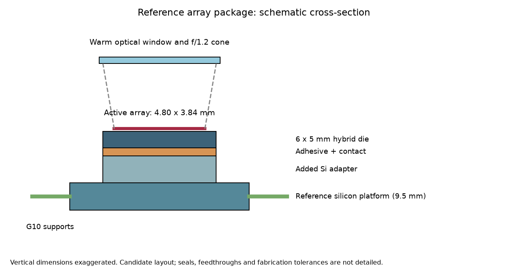
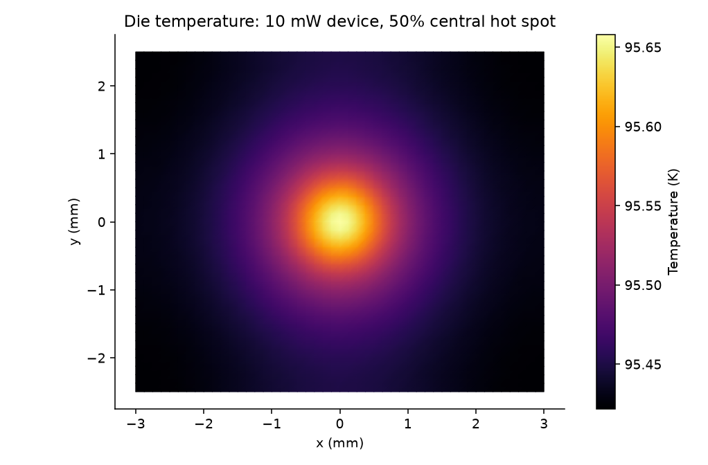
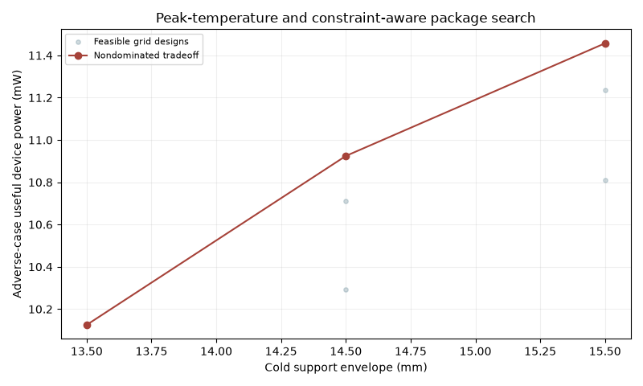
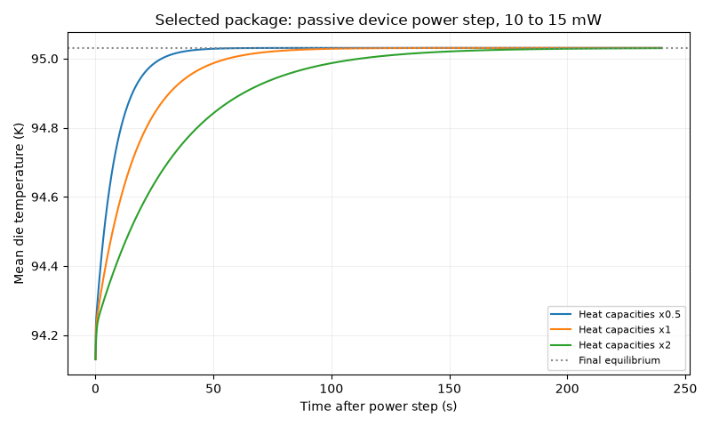

# Expanded study: packaging-constrained JT microsystem cooling

## Main conclusion

The corrected literature-format array materially changes the package budget.
The 3 x 3 mm / 5 mg placeholder from the exploratory study cannot represent a
320 x 256 array at 15 um pitch with its cold platform. The new reference design
uses a 6 x 5 mm die envelope, separate signal/power wires and a 450 mg cold-assembly
mechanical allowance. Its baseline useful-power limit is 22.4 mW at 100 K
mean die temperature. This replaces the earlier roughly 45 mW estimate for this application.

After a constrained grid search, the best candidate gives **28.5 mW nominally**
and **11.5 mW in the prescribed adverse scenario**, both at a **100 K peak-die limit**.
Only 7 of 1134 examined designs meet the 10 mW requirement in that
scenario. This is a narrow conditional margin, not a qualified hardware rating.

## Study status, in requested priority order

| Priority | Work delivered | Status |
|---|---|---|
| 1 | Array dimensions, stack, wiring groups, optical cone, mass allowance, enclosure allocation and source/assumption ledger | Complete as a reference design; commercial detector requirements remain unspecified |
| 2 | 3D thermal stack FE, 2D cooldown-mismatch FE, mesh studies, property sensitivity and support screens | Complete within documented model scope; material/joint qualification pending |
| 3 | Single-parameter calibration, held-out temperatures and external-benchmark eligibility audit | Full-text/supplement audit, heat-budget reproduction and conditional gas-runtime comparison complete; independent thermal validation remains open |
| 4 | 1,134-design search, adverse constraints, Pareto tradeoff and FE confirmation of peak-temperature boundary | Complete as a discrete conditional optimization |
| 5 | Local electrical power step, energy balance, heat-capacity sensitivity and solver checks | Complete as a quasi-steady-cooler transient approximation |

## Selected grid candidate

- Four G10 supports: 3.0 mm long, 0.3 mm wide,
  0.35 mm thick; 15.5 mm cold support envelope.
- Twelve 25 um signal wires and four 75 um power/return wires; thermal length 8 mm.
- Full-area candidate adhesive bond: 25 um; contact resistance remains an assumption.
- Adverse support deflection: 6.62 um against the assumed 10 um limit.
- The selected thinner bond improves heat transfer but increases predicted cooldown
  warpage to about 3.71 um and central die equivalent stress to
  16.8 MPa in the elastic cross-section model.
  No applicable bond failure criterion is available; reliability is not established.

## What the new analyses show

**Spatial temperature matters.** At the baseline 10 mW device load, the fine thermal
mesh predicts a 95.658 K hot spot compared with a
95.460 K mean. The mesh refinement changes the peak by about 0.006 K.

**Calibration does not remove the validation gap.** Fitting only a radiation-area
multiplier reduces training error to 2.60 mW RMSE; the held-out error is
7.62 mW. The 95 K point remains poorly predicted. The multiplier is an
empirical discrepancy parameter and is not used for the package power ratings.

**Response time depends on uncertain thermal mass.** A nominal 10-to-15 mW step gives
a mean die rise from 94.130 to 95.031 K and a
65.4 s settling time to within 2% of the final change. The heat-capacity
sensitivity spans 32.7–130.8 s.
The 15 mW endpoint exceeds the adverse-case allowable power: this demonstration is
nominal only. Startup, fluid dynamics and heater control are not modeled.

## Read the deliverables

1. [Reference design and source ledger](../../docs/01_array_specification.md)
2. [Thermal/mechanical FE report](02_fem_report.md)
3. [Calibration and independent-validation audit](03_validation_audit.md)
4. [Constrained optimization report](04_optimization.md)
5. [Transient response report](05_transient.md)
6. [Methods, equations and limitations](../../docs/advanced_methods.md)









## Additional physical studies

The [extension report](../extensions/report.md) adds a distributed gas/wall/insulation
model and spatial bond-defect screening. The exchanger is restricted to vapor
return above110 K and has an unresolved internal heat-budget discrepancy. Bond
defects are coupled back into the package network and can remove the candidate's
adverse10 mW margin. The original intact-bond ratings above remain reference cases.

## Verification and reproducibility

The project has 43 passing verification tests, including analytical layered
conduction, stress-free matched thermal contraction, FE heat/force balances,
peak-temperature target recovery, spectral bounds and transient energy closure.
Numerical verification does not validate the assumed material properties.

Run, in order:

```sh
python run_array_fem.py
python run_calibration_audit.py
python run_external_validation.py
python run_supplement_audit.py
python run_array_optimization.py
python run_array_transient.py
python -m unittest -v
python build_advanced_overview.py
```

`provenance.json` records software versions and input/source hashes. CSV/JSON
results and plotting code are included. Publisher PDFs and extracted full text
remain outside shareable outputs. Nothing has been published to GitHub.

## Evidence still needed

Both Pei main PDFs have now been read. See [the external comparison](06_external_evidence.md)
and [the source ledger](../../docs/benchmark_candidates.md). The gas-runtime check
agrees conditionally with the reported interval; it does not validate the thermal
package. The 2024 optical test uses active PID control, and the 2026 gas tests and
detector demonstration use different chips. The supplied S1-S3 supplement has now been audited in
[the supplementary report](07_supplement_audit.md). Its heat-load estimates are
reproduced without fitting. Exhaust loss is inferred using measured net power;
this closure cannot independently validate predicted net capacity.
Matching geometry, boundary conditions and temperature/load traces remain necessary
for independent thermal validation.

The term paper can now defend a substantial computational contribution:
**a reproducible, constraint-aware package design study that combines measured
cooler capacity, spatial hot spots, cooldown mismatch and local transient response.**
Journal novelty, manufacturability and experimentally demonstrated performance
remain separate questions.
