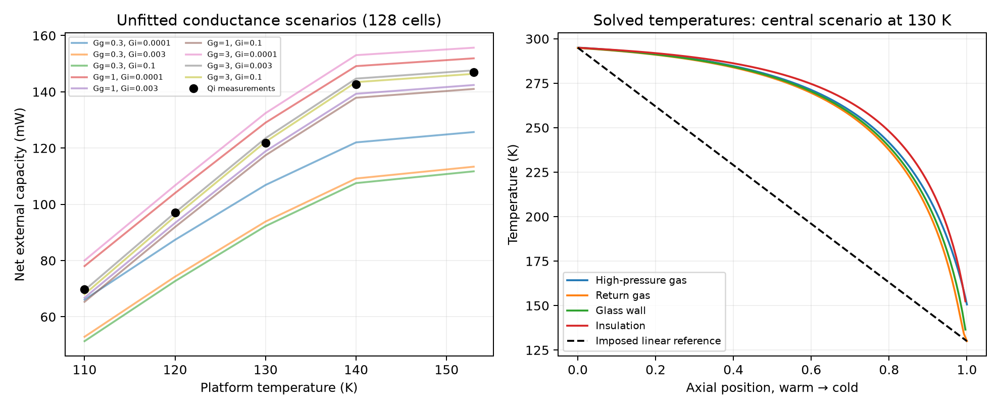
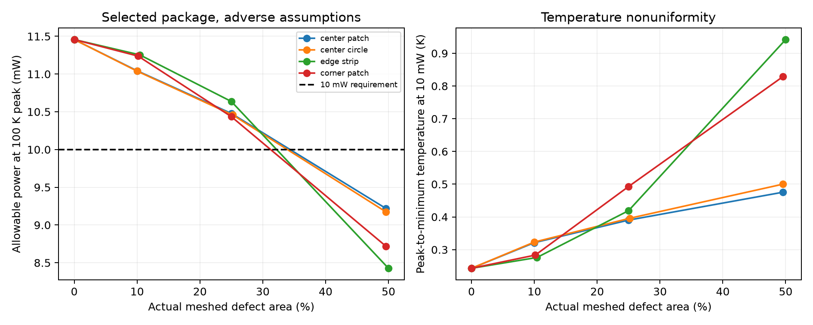
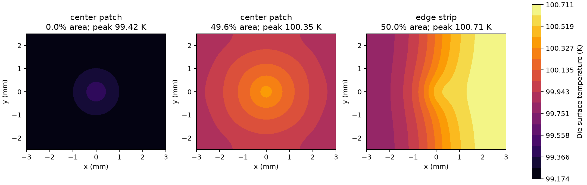

# Extension studies: exchanger physics and bond defects

## Main findings

1. **Bond quality can consume the remaining design margin.** For the selected
   package under the existing adverse assumptions, intact allowable power is
   **11.46 mW**. A 25% central degraded patch lowers it to
   **10.48 mW**; a 50% edge strip lowers it to
   **8.43 mW**, failing the 10 mW requirement.
2. **Solving temperatures changes the exchanger loss estimate, but does not
   establish model adequacy.** At130 K, the central distributed scenario predicts
   **118.87 mW** net capacity on 128 cells, compared with 121.9 mW
   in Qi's manually read measurement. Refining to 256 cells gives
   **119.33 mW**. Its large computed wall heat into the cold platform
   is an unresolved internal-budget discrepancy, despite a close net result.
3. The exchanger extension is deliberately restricted to vapor return at
   platform temperatures110–153 K. It **does not update the original100 K rating**.
   All heat-transfer conductances are stated scenarios, not calibrated measurements.

Methods and source/assumption definitions: [extension methods](../../docs/extension_methods.md).

## A. Distributed exchanger and insulation

The model solves high-pressure gas, return gas, glass wall and insulation
temperatures, including wall conduction and explicit warm/cold wall anchors.
Unlike the original imposed linear radiation profile, insulation temperature is
found from radiation input and thermal coupling to the wall. Flow remains
prescribed from Qi at each temperature. There is no hydraulic closure or
two-phase exchanger correlation, and no new fitting to measured capacity.

### Constitutive screen at 130 K

Gg is total conductance on each gas side; Gi is total wall-to-insulation conductance.

| Gg W/K | Gi W/K | Predicted net mW | Exchanger radiation mW | Wall → cold platform mW |
|---:|---:|---:|---:|---:|
| 0.3 | 0.0001 | 106.88 | 4.01 | 300.0 |
| 0.3 | 0.003 | 93.87 | 18.99 | 305.5 |
| 0.3 | 0.1 | 92.25 | 20.99 | 306.1 |
| 1 | 0.0001 | 129.04 | 2.82 | 457.1 |
| 1 | 0.003 | 118.87 | 13.70 | 463.0 |
| 1 | 0.1 | 117.45 | 15.27 | 463.8 |
| 3 | 0.0001 | 132.43 | 2.39 | 593.6 |
| 3 | 0.003 | 123.52 | 11.72 | 600.1 |
| 3 | 0.1 | 122.23 | 13.11 | 601.0 |

The scenario spread is **92.3–132.4 mW**,
not a probability interval. The insulation radiation range is
**2.4–21.0 mW**.
Comparison across all five eligible points is saved in `distributed_hx.csv`.
These are conditional comparisons using measured flow, not independent validation.

### Mesh resolution and physical adequacy

| Cells | Net mW | Exchanger radiation mW | Wall → cold platform mW |
|---:|---:|---:|---:|
| 16 | 89.962 | 18.796 | 282.04 |
| 32 | 110.442 | 15.783 | 385.47 |
| 64 | 117.062 | 14.227 | 442.56 |
| 128 | 118.867 | 13.702 | 463.01 |
| 256 | 119.328 | 13.558 | 468.90 |

The central128-to 256-cell net change is **0.461 mW**.
The largest change at the three additionally checked scenario corners is
**1.067 mW**. This is a numerical resolution check at 130 K, not a uniform
error bound for all temperatures or conductances. Cold-anchor heat converges
more slowly and is reported rather than hidden by the net balance.

**Do not interpret the net agreement as a validated correction.** The assumed
continuous glass cross-section, shared wall, thermal anchors and film conductances
produce hundreds of milliwatts of wall heat entering the cold platform. That
behavior is in tension with the below 2 mW axial-loss scale reported in Qi's
model diagnostics and used in Pei's supplementary accounting. The heat-flow
definitions and hardware boundaries need reconciliation before treating these
as directly identical quantities. It nevertheless prevents claiming that the
internal physics has been validated by a matching net capacity.

The model conserves energy, but large internal heat circulation can cancel in
the net result. All saved130 K profiles pass an independent whole-device entropy
screen (minimum **0.0073 W/K**). Conservation and a nonnegative entropy
balance are necessary checks, not proof that the assumed thermal paths represent
the real cooler. No scenario is promoted to a replacement reference curve.

The finite-contact screen reports successful vapor solutions and rejected
nonlinear cases separately. Rejection at 110 K with nonzero contact resistance
is not proof of physical infeasibility; it may require a wet-return formulation
or a more robust solver. Extending below 110 K by interpolation is disallowed.

### Propagation to an illustrative package target

Using the selected package at a separate **130 K mean-die** target produces
**61.7–98.9 mW** useful power across these scenarios.
This demonstrates how unresolved cooler physics affects a package calculation.
It is not the 100 K peak-temperature requirement, not a new infrared performance
specification, and not a validated rating. All interpolations stay within110–153 K.

## B. Bond-defect sensitivity of the selected package

The thermal bond contains an imposed low-conductivity region, set to 10^-4 of
intact effective conductivity. It is a poor-contact surrogate, not a measured
vacuum void or a crack-growth model. Central/corner patches are rectangular,
with the same6:5 aspect ratio as the die. The actual meshed area is shown below.

Each defect geometry has separate uniform and localized1 W FE load bases. Their
full temperature fields and area means are recombined inside the nonlinear
package solve. The intact scalar interface resistance is not reused for a
defective bond, and separate maxima are not added together.

### Adverse-condition results at the original100 K peak limit

| Defect footprint | Actual area % | Allowable power mW | Peak at 10 mW K | Peak-to-minimum at 10 mW K |
|---|---:|---:|---:|---:|
| center patch | 0.00 | 11.46 | 99.417 | 0.243 |
| center patch | 10.00 | 11.04 | 99.573 | 0.321 |
| center patch | 25.00 | 10.48 | 99.799 | 0.390 |
| center patch | 49.58 | 9.22 | 100.350 | 0.476 |
| center circle | 10.00 | 11.04 | 99.575 | 0.323 |
| center circle | 25.21 | 10.46 | 99.807 | 0.396 |
| center circle | 49.58 | 9.17 | 100.371 | 0.500 |
| edge strip | 10.42 | 11.25 | 99.494 | 0.276 |
| edge strip | 25.00 | 10.64 | 99.743 | 0.419 |
| edge strip | 50.00 | 8.43 | 100.711 | 0.942 |
| corner patch | 10.16 | 11.24 | 99.500 | 0.283 |
| corner patch | 25.00 | 10.44 | 99.823 | 0.493 |
| corner patch | 49.58 | 8.72 | 100.570 | 0.829 |

Small central defects directly beneath the heat source are more harmful than
some equally sized edge defects, but the ordering changes for large regions.
A large edge strip forces substantial lateral spreading through the die and
can move the hottest point away from the imposed central source. Therefore,
defect area alone is not a sufficient thermal acceptance measure.

At25% area, all four tested shapes still meet10 mW, with reduced margin. At
approximately50%, all four fail under the adverse assumptions. This is a result
for sampled shapes and area fractions, not a precise allowable-void threshold.
Nominal results and all 26 primary cases are saved in `bond_defects.csv`.

### Mesh and conductivity sensitivity

The convergence case has an exactly 25% centered rectangle on each mesh:

| Mesh level | Nodes | Actual area % | Allowable power mW | Peak at 10 mW K |
|---:|---:|---:|---:|---:|
| 4 | 3150 | 25.00 | 10.4962 | 99.7917 |
| 8 | 22099 | 25.00 | 10.4780 | 99.7990 |
| 12 | 71248 | 25.00 | 10.4744 | 99.8005 |

The level 8-to 12 power change is **0.0036 mW**.
The intact FE solution and allowable-power calculation recover the earlier model;
a uniformly degraded whole bond recovers analytical layered resistance.
The maximum1 W basis energy residual across the primary cases is
**8e-13 W/W**.

For the 25% central patch, changing the defect conductivity ratio from 10^-4 to 0.1
gives allowable power from **10.478 to
10.607 mW**. All are assumptions about
thermal contact. Defect morphology, gap gas/radiation and interface measurements
would be needed to connect this screen to manufacturing acceptance criteria.
Bond stress redistribution and reliability are not established by this thermal study.

## What this adds to the project

The contribution is now stronger than an ideal-bond geometry search: it tests
whether the candidate survives spatial interface defects and shows why a good
net-capacity fit is insufficient evidence for a distributed cooler model.
The43-test suite covers both extensions alongside the original studies.
Remaining experimental gaps are explicit; neither extension is presented as
an independently validated manufactured design.

Reproduce using the commands in [extension methods](../../docs/extension_methods.md).
The original baseline configurations and results remain available for comparison.
